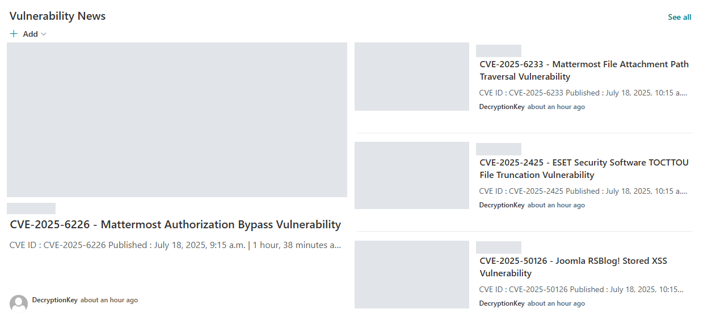

# RSS to SharePoint News

A Power Automate cloud flow that watches an RSS feed and republishes each new item as a SharePoint News post. I built it to bring new CVE disclosures into a SharePoint "Vulnerability News" page so people could see them without anyone posting by hand.

## Overview

| | |
|---|---|
| **Platform** | Microsoft Power Automate (cloud flow) |
| **Connectors** | RSS, Content Conversion, SharePoint |
| **Trigger** | RSS "When a feed item is published", checked every minute |
| **Output** | SharePoint News link post (title, summary, original URL) |
| **Example feed** | `https://cvefeed.io/rssfeed/latest.xml` |

## How it works

1. **Trigger** – the RSS connector polls the feed every minute and fires once per new item.
2. **Clean up** – the item summary goes through the Content Conversion **Html to text** action so the post shows plain, readable text.
3. **Publish** – **Send an HTTP request to SharePoint** sends a `POST` to `/_api/sitepages/pages/reposts` with a `SP.Publishing.RepostPage` body. That creates a News link with the item's title, description, and original URL, published immediately (`ShouldSaveAsDraft: false`).

The trimmed trigger and action definitions are in [`flow/definition.json`](flow/definition.json) if you want to read the logic without importing anything.

## Repository contents

| Path | What it is |
|---|---|
| `flow/RSS-to-SharePoint-News.zip` | Exported flow package for import |
| `flow/definition.json` | Readable copy of the trigger and actions |
| `docs/news-output.png` | Example of the resulting News posts |

The export has been sanitized. The SharePoint site is a placeholder (`https://contoso.sharepoint.com/sites/YourNewsSite`), and tenant and user identifiers are zeroed out.

## Requirements

- Power Automate with access to the RSS, Content Conversion, and SharePoint connectors
- A SharePoint communication site with News enabled
- An account that can create pages on that site

## Setup

1. In Power Automate, go to **My flows → Import → Import Package (Legacy)** and upload `flow/RSS-to-SharePoint-News.zip`.
2. Create or select connections for RSS, Content Conversion, and SharePoint.
3. Open the flow and change:
   - the feed URL in the trigger
   - the **Site Address** in the SharePoint HTTP action (replace the `contoso` placeholder)
   - optionally, the banner image URL in the request body
4. Test with a feed that updates often, then turn the flow on.

## Testing

I ran the flow against a sandbox SharePoint site for several days. Every new feed item showed up as a News post with the right title, summary, and link.

## Limitations and ideas

- Formatting is reduced to plain text.
- Polling every minute on a busy feed creates a lot of posts. A **Filter** or **Condition** step on keywords or severity (for example, only CVSS ≥ 7) would cut the noise.
- Runs are subject to RSS provider and SharePoint API throttling.
- The flow could also send a Teams notification for critical items.

## What I learned

- How Power Automate's connectors chain together, and when you have to drop to a raw SharePoint REST call because no built-in action covers the job
- How the SharePoint `reposts` endpoint and its `SP.Publishing.RepostPage` payload work
- Why exports must be sanitized before sharing. A default export includes tenant IDs, the creator's account, and internal site URLs.

## Skills demonstrated

Workflow automation · Power Automate · SharePoint REST API · vulnerability intelligence feeds · documentation

## License

MIT. See [LICENSE](LICENSE).
